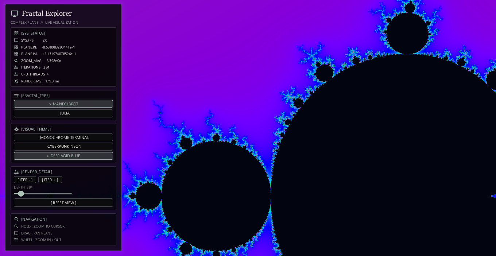

<div align="center">

<h1>🌌 Fractal Explorer</h1>



**A native Mandelbrot and Julia set explorer** built with Rust and CreamUI, featuring responsive navigation, parallel CPU rendering, and deep-zoom detail.

</div>

---

## Overview

Fractal Explorer is a desktop application for exploring the Mandelbrot and Julia sets. Its CreamUI interface keeps rendering controls and live diagnostics alongside the fractal canvas, while Rayon distributes pixel calculations across CPU threads.

The last complete frame is transformed during navigation so the canvas stays responsive while a new preview is rendered. After interaction stops, the preview is replaced with a full-quality frame.

### Features

- **Mandelbrot and Julia sets** with three selectable color palettes.
- **Cursor-centered zoom** using the mouse wheel, plus continuous hold-to-zoom on the canvas.
- **Click-and-drag panning** with a movement threshold to distinguish panning from hold-to-zoom.
- **Adaptive iteration depth** that increases as you zoom in; adjust it manually with the slider or iteration buttons.
- **Live diagnostics** for FPS, render time, zoom, complex-plane coordinates, and CPU thread count.
- **Parallel CPU rendering** with Rayon; no dedicated graphics card is required.
- **Deep zoom support** using double-double camera coordinates and perturbation rendering, up to a zoom factor of `1e24`.
- A dark interface with muted green-gray accents, serif title, and monospaced controls, implemented with CreamUI.

---

## Architecture and Technologies

- **Rust 2021** with a minimum supported Rust version of **1.85**.
- **CreamUI 0.3** for the native desktop interface and image display.
- **Rayon 1.10** for parallel pixel rendering across CPU threads.
- **Custom fractal renderer** with smooth iteration-based coloring and adaptive iteration limits.
- **Release profile** configured with full link-time optimization, a single codegen unit, and optimization level 3.

### Rendering and precision

Fractal images are calculated on the CPU in parallel; the application does not require a GPU. During interaction, it transforms the most recent complete frame and schedules a lower-resolution preview before rendering the final image.

Camera coordinates use double-double arithmetic, and the renderer uses a reference orbit with perturbation at high zoom. This preserves detail beyond the range where ordinary `f64` coordinates are sufficient. It is not arbitrary-precision arithmetic or literally infinite zoom: the camera is capped at `1e24`, and deeper zoom would require a wider precision implementation.

---

## Repository Structure

```text
mandel-engine/
├── src/
│   ├── camera.rs    # Camera, complex-plane coordinates, and extended precision
│   ├── fractal.rs   # Mandelbrot/Julia calculations and parallel rendering
│   ├── main.rs      # CreamUI application, controls, and render coordination
│   └── palette.rs   # Color palettes and smooth iteration coloring
├── Cargo.toml       # Dependencies and release build settings
├── Cargo.lock       # Locked dependency versions
└── README.md
```

---

## Prerequisites

- Rust **1.85 or newer** and Cargo.
- A desktop platform supported by the installed CreamUI dependencies. CreamUI's upstream desktop support may vary by operating system and version; check its current platform requirements if native dependencies fail to build.

A dedicated graphics card is not required. Rendering is performed on the CPU, and Rayon uses the available worker threads.

---

## Installation and Development

Run these commands from the project directory:

```bash
cargo build
```

### Run the application

For an optimized build:

```bash
cargo run --release
```

For a development build:

```bash
cargo run
```

### Tests and checks

Run the unit tests:

```bash
cargo test
```

Check formatting and lint the project:

```bash
cargo fmt --check
cargo clippy --all-targets -- -D warnings
```

Check that the optimized configuration compiles:

```bash
cargo check --release
```

---

## Controls

| Input | Action |
|---|---|
| Mouse wheel | Zoom in or out around the cursor |
| Hold the mouse button on the canvas | Continuously zoom toward the cursor |
| Drag on the canvas | Pan around the complex plane |
| `ITER -` / `ITER +` or the depth slider | Change the iteration limit |
| Fractal selector | Switch between Mandelbrot and Julia |
| Palette selector | Choose Monochrome Terminal, Cyberpunk Neon, or Deep Void Blue |
| `RESET VIEW` | Restore the default camera |

Clicks, drags, and scrolling that start over the sidebar do not navigate the fractal.
