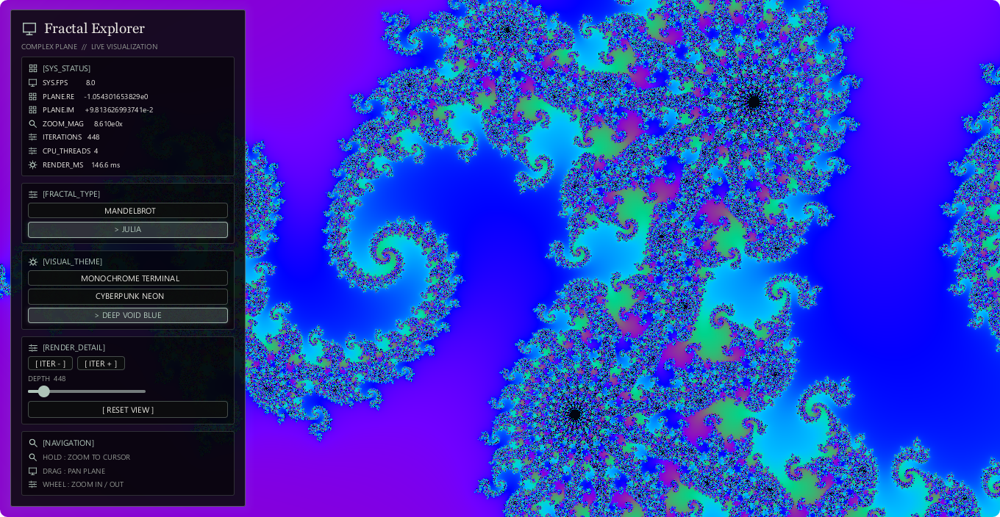

<div align="center">

<h1>🌌 Fractal Explorer</h1>

A native fractal exploration experience built in Rust, designed for deep zoom inspection and high-quality rendering without requiring a GPU.

[](https://www.rust-lang.org/)
[](https://doc.rust-lang.org/edition-guide/rust-2021/index.html)
[](https://crates.io/crates/creamui)
[](https://crates.io/crates/rayon)

</div>

<div align="center">
  
</div>

## Overview

Fractal Explorer is a desktop application for exploring the Mandelbrot and Julia sets with live controls, adaptive precision, and a polished native UI. It combines a fast CPU-based renderer, deep zoom, and detailed inspection of fine structure without sacrificing interactivity.

The application continuously transforms the last complete frame while a preview is rendered, keeping the canvas responsive during interaction. Once motion stops, the preview is replaced by a high-detail final frame.

## Key Features

- Mandelbrot and Julia fractal modes with three selectable color palettes.
- Cursor-centered zoom via mouse wheel and hold-to-zoom interactions.
- Smooth panning with threshold-based input handling for precise navigation.
- Adaptive iteration depth that scales with zoom, plus manual fine-tuning controls.
- Real-time diagnostics including FPS, render time, zoom level, coordinates, and CPU thread count.
- Parallel CPU rendering using Rayon, enabling high-performance rendering on standard desktop hardware.
- Deep-zoom support with double-double camera coordinates and perturbation rendering for detail preservation up to approximately `1e24` zoom.
- Dark, modern interface with muted green-gray accents and a native desktop layout built with CreamUI.

## Architecture

Fractal Explorer is built around a small but efficient rendering pipeline:

- `src/main.rs` starts the application and coordinates window events.
- `src/components/` assembles CreamUI widget trees with the `jsx!` macro. The sidebar and its controls are organized into separate modules; the fractal canvas is a custom `Widget` for image rendering and pointer input.
- `src/fractal.rs` contains the Mandelbrot and Julia calculations and parallel renderer.
- `src/camera.rs` handles complex-plane transformations and extended precision math.
- `src/palette.rs` defines the available palettes and smooth iteration-based coloring.

### Rendering model

The renderer performs calculations on the CPU in parallel, avoiding the requirement for a dedicated GPU. During interaction, the app reuses the most recent complete frame and schedules a lower-resolution preview before replacing it with a full-quality render.

Camera coordinates are managed using double-double arithmetic, while perturbation-based refinement preserves detail at high zoom. This does not provide arbitrary-precision math or infinite zoom, but it significantly extends the practical range of exploration before precision limits are reached.

## Project Structure

```text
fractales/
├── assets/
│   └── fractal.png         # Application preview image
├── src/
│   ├── camera.rs           # Camera math and extended precision logic
│   ├── components/
│   │   ├── fractal_canvas.rs
│   │   └── sidebar/
│   │       ├── diagnostic_row.rs
│   │       ├── fractal_mode.rs
│   │       ├── navigation.rs
│   │       ├── palette.rs
│   │       ├── render_details.rs
│   │       ├── section_card.rs
│   │       ├── status.rs
│   │       └── terminal_button.rs
│   ├── fractal.rs          # Fractal algorithms and parallel rendering
│   ├── main.rs             # Application state and render orchestration
│   └── palette.rs          # Color palettes and smooth iteration coloring
├── Cargo.toml              # Package metadata and dependencies
├── Cargo.lock              # Locked dependency versions
├── README.md               # Project documentation
└── target/                 # Build artifacts
```

## Requirements

- Rust 1.85 or newer
- Cargo
- A desktop platform supported by the installed CreamUI dependencies

No dedicated graphics card is required. Rendering is handled by the CPU using Rayon and the available worker threads.

## Getting Started

### Install dependencies

```bash
cargo build
```

### Run the app

Development build:

```bash
cargo run
```

Optimized release build:

```bash
cargo run --release
```

### Run tests

```bash
cargo test
```

### Validate formatting and linting

```bash
cargo fmt --check
cargo clippy --all-targets -- -D warnings
```

### Check release compilation

```bash
cargo check --release
```

## Controls

| Input                                   | Action                                  |
| --------------------------------------- | --------------------------------------- |
| Mouse wheel                             | Zoom in or out around the cursor        |
| Hold mouse button on the fractal canvas | Continuous zoom toward the cursor       |
| Drag on the fractal canvas              | Pan around the complex plane            |
| `-` / `+` or the depth slider           | Adjust iteration depth                  |
| Fractal selector                        | Switch between Mandelbrot and Julia     |
| Palette selector                        | Choose among the available color themes |
| `Reset View`                            | Restore the default camera position     |
